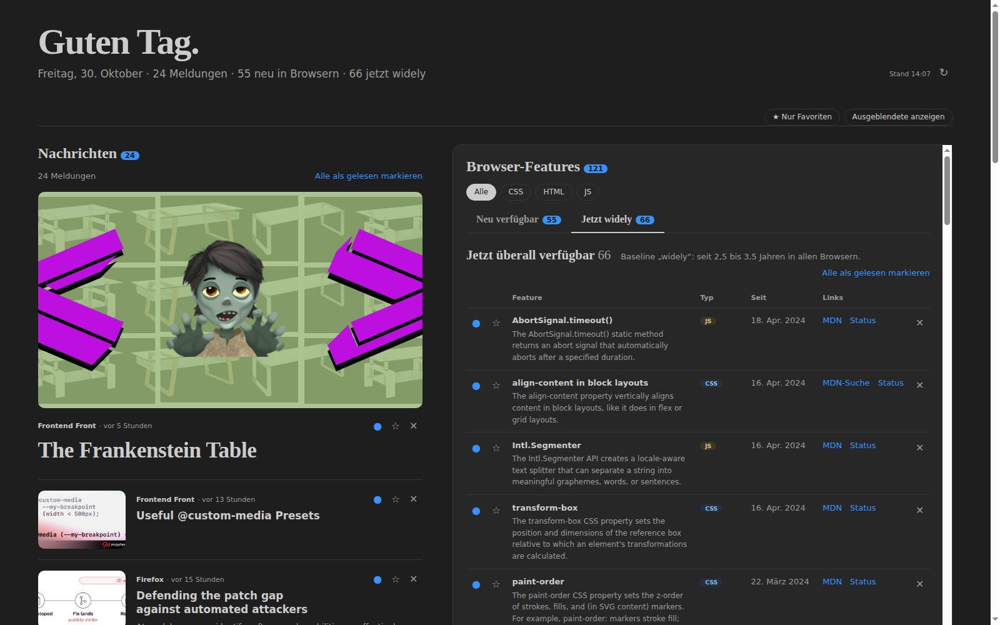
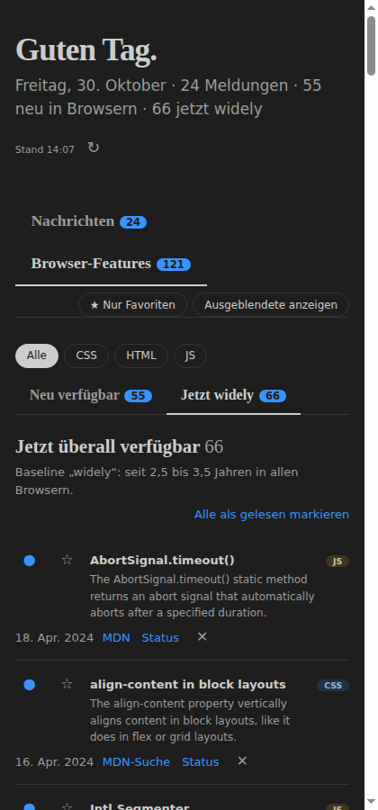

# Web Dev Welcome

**Dein täglicher Web-Dev-Überblick direkt in VS Code:** aktuelle News aus der Frontend-Welt und die neuesten Browser-Features (Baseline) für CSS, HTML und JavaScript, mit Favoriten, Gelesen-Status und Ungelesen-Zähler.



## Was die Extension macht

- **Tägliche Begrüßung**: Beim ersten Start von VS Code am Tag öffnet sich ein Tab mit den neuesten Meldungen und Features. Danach bleibt es still, bis du es selbst öffnest.
- **News** aus 13 Quellen, nach Datum sortiert, mit Bild und Kurzbeschreibung: web.dev, Chrome, WebKit, Mozilla Hacks, Firefox, CSS-Tricks, Smashing Magazine, Frontend Focus, JavaScript Weekly, Frontend Front sowie Releases von **Vue** und **Nuxt** (nur stabile Versionen, keine RCs) und der Nuxt-Blog.
- **Browser-Features** aus [web-features](https://github.com/web-platform-dx/web-features) (Baseline), gefiltert nach CSS, HTML und JS:
  - **Neu verfügbar** (Baseline _newly_): seit weniger als einem Jahr in allen Kernbrowsern.
  - **Jetzt widely** (Baseline _widely_): im letzten Jahr überall verfügbar geworden, also seit 2,5 bis 3,5 Jahren.
  - Ältere Einträge sind je Bereich eingeklappt. Jeder Eintrag verlinkt auf MDN (aus den [Browser-Compat-Daten](https://github.com/mdn/browser-compat-data)) und auf [webstatus.dev](https://webstatus.dev).
- **Ordnung im Strom**: Jeder Eintrag lässt sich als gelesen markieren, als Favorit sternen oder ausblenden. „Nur Favoriten“, „Ausgeblendete anzeigen“ und „Alle als gelesen markieren“ helfen beim Aufräumen.
- **Ungelesen-Zähler** als Badge am Icon in der Activity Bar.
- **Sidebar und Tab**: Dieselbe Ansicht gibt es im Seitenmenü und als Editor-Tab. Markierungen werden zwischen beiden sofort synchronisiert.
- **Responsiv**: Breit stehen News und Features nebeneinander, in der schmalen Sidebar wechselst du per Tab. Helles und dunkles Theme folgen VS Code.



## Installation

Es gibt (noch) keinen Marketplace-Eintrag. Du baust dir die Extension einmal selbst und installierst sie aus der `.vsix`-Datei.

**Voraussetzungen:** VS Code ab 1.90, Node.js `^22.18`, `^24.11` oder `>=26`, [pnpm](https://pnpm.io/installation).

```bash
git clone git@github.com:mkoeppen/welcome-webdev.git
cd welcome-webdev
pnpm install
pnpm package        # baut und erzeugt webdev-welcome-<version>.vsix
```

Dann in VS Code installieren, entweder per Kommandozeile …

```bash
code --install-extension webdev-welcome-0.1.0.vsix
```

… oder in der Oberfläche: Extensions-Ansicht → Menü **⋯** → **Aus VSIX installieren …**.

Anschließend das Fenster neu laden (`Ctrl+Shift+P` → **Developer: Reload Window**). Das Globus-Icon erscheint in der Activity Bar.

> **Remote/WSL:** Die Extension läuft im Workspace-Host. Führe `code --install-extension` in dem Terminal aus, in dem auch dein Remote-Fenster läuft, oder installiere die VSIX direkt aus dem Remote-Fenster.

## Benutzung

| Aktion                         | So geht's                                                                                                      |
| ------------------------------ | -------------------------------------------------------------------------------------------------------------- |
| Übersicht öffnen               | Globus-Icon in der Activity Bar, Globus in der Editor-Toolbar oder `Ctrl+Shift+P` → **Web Dev Welcome öffnen** |
| Neu laden                      | **↻** neben „Stand …“ lädt Feeds und Baseline-Daten sofort neu                                                 |
| Gelesen / ungelesen            | Kreis links am Eintrag (gefüllt = ungelesen), oder ein Klick auf den Link                                      |
| Favorit                        | Stern am Eintrag, dann oben „★ Nur Favoriten“                                                                  |
| Ausblenden                     | ✕ am Eintrag, wieder einblenden über „Ausgeblendete anzeigen“                                                  |
| Bereich auf einmal als gelesen | „Alle als gelesen markieren“ über der Liste                                                                    |
| Features filtern               | Chips „Alle / CSS / HTML / JS“ und die Unter-Tabs „Neu verfügbar“ / „Jetzt widely“                             |

Ältere Features außerhalb des Ein-Jahres-Fensters gelten ohne eigene Markierung als gelesen und erhöhen den Zähler nicht.

## Daten und Datenschutz

- Die Extension braucht keinen Account und sendet keine Telemetrie.
- Sie lädt von `cdn.jsdelivr.net` (web-features und Browser-Compat-Daten), von den News-Feeds und von den verlinkten Artikelseiten, um fehlende Vorschaubilder zu finden.
- News werden 6 Stunden zwischengespeichert, die MDN-Links 7 Tage (die Compat-Daten sind ca. 20 MB groß). Der Refresh-Button umgeht den Cache. Ohne Netz bleibt der letzte Stand sichtbar.
- Markierungen und Cache liegen lokal im VS-Code-Speicher der Extension (`globalState`).

## Entwicklung

Das Projekt nutzt [Vite+](https://viteplus.dev) (`vp`), Vue 3, TypeScript und Sass.

```bash
pnpm install
pnpm dev            # Webview im Browser, mit Beispieldaten (src/webview/dev-data.ts)
pnpm test           # Unit-Tests; LIVE=1 pnpm test prüft zusätzlich die echten Feeds
pnpm check          # Format + Lint
pnpm typecheck      # vue-tsc
pnpm build          # dist/extension.cjs + dist/webview/
```

Extension im Debug-Fenster ausprobieren (ohne Installation):

```bash
pnpm build
code --extensionDevelopmentPath="$PWD"
```

### Aufbau

| Pfad           | Inhalt                                                                     |
| -------------- | -------------------------------------------------------------------------- |
| `src/host/`    | Extension-Host: Laden, Cache, Webview-Anbindung → `dist/extension.cjs`     |
| `src/webview/` | Vue-App und SCSS → statisches Build in `dist/webview/`                     |
| `src/shared/`  | Typen, Markierungs- und Zähl-Logik, von Host und Webview gemeinsam genutzt |

Der Host liest `dist/webview/index.html`, schreibt die Asset-URLs auf Webview-URIs um, ergänzt eine strikte Content-Security-Policy und schickt die Daten nach einer `ready`-Nachricht der Webview per `postMessage`. Die News-Quellen stehen oben in [`src/host/load.ts`](src/host/load.ts) in der Liste `FEEDS`.

## Lizenz

[MIT](LICENSE)
